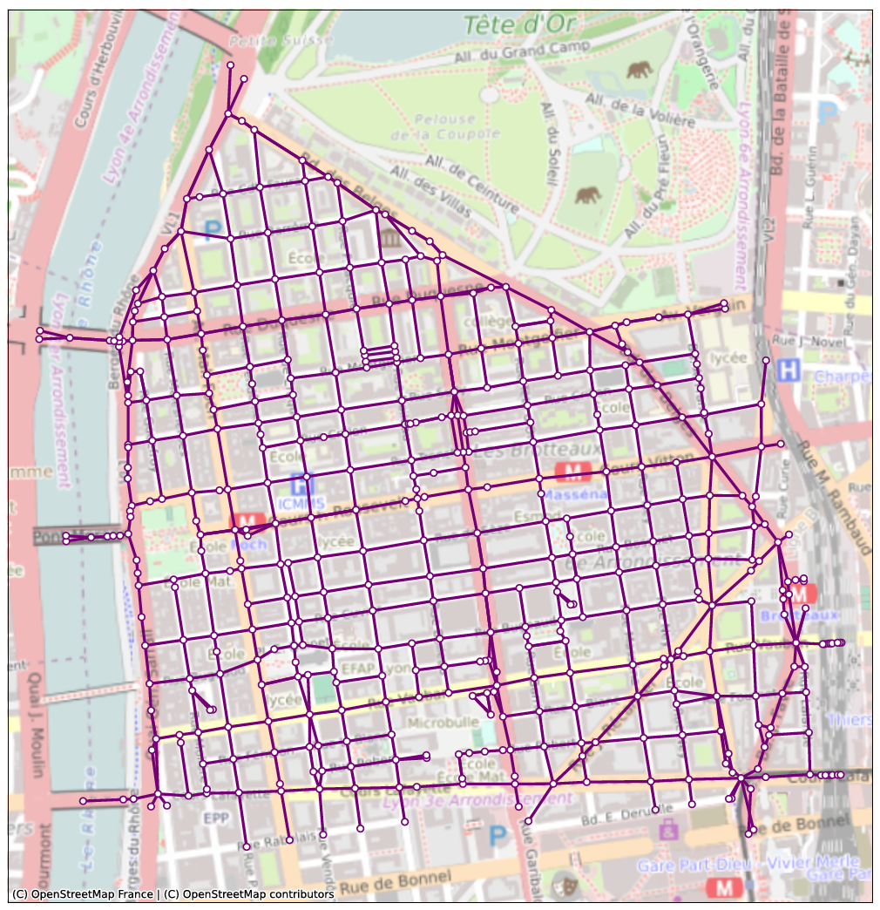

# 'LYON6' EXAMPLE

This repository contains Lyon6 example, this is the simplest one based on a real network.
It extends on the 6th district of Lyon city, France. It has only one transportation layer for one personal vehicle mobility service.


<figure align="center">
  
  <figcaption>Lyon6 network</figcaption>
</figure>

The origin-destination layer matches this layer’s nodes.
There is one reservoir including all links with a varying speed with accumulation.
There are two versions of this scenario, one with an assumed links classification and another one without any classification. The classification recognizes primary and secondary roads as represent[...]
To influence users paths based on this classification, the study case uses the cost functions to apply a certain multiplier to the travel time depending on the link class. The new cost considered [...]
compute shortest paths is called weighted travel time.

## Running the simulation

From the repository root, run the simulation with the default parameter file:

```bash
python examples/Lyon6/runLyon6.py
```

By default, the script uses `param.json`, with no road classification. To use another parameter file,
pass its path as the first argument :

```bash
python examples/Lyon6/runLyon6.py examples/Lyon6/param_roadstypo.json
```

Here `param_roadstypo.json` is the parameter file which enables the road classification.

Simulation outputs are written to the configured output directory.

## Exploring the input and output

The notebook [`Lyon 6 roads typology.ipynb`](./Lyon%206%20roads%20typology.ipynb)
visualizes the primary and secondary road sections defined in
`param_roadstypo.json`, then compares link usage with and without the road
typology cost multipliers.
